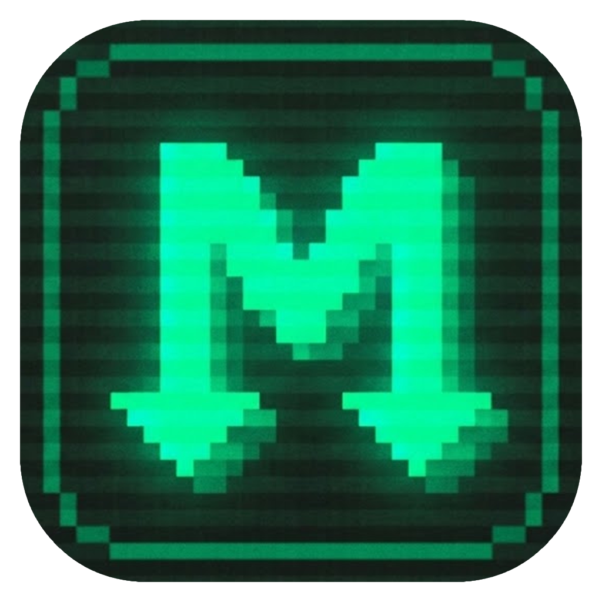

<div align="center">



# ⚡ Mercatcher
### Next-Gen Bulk Media & File Downloader Pro

[](https://www.python.org/)
[](LICENSE)
[](https://microsoft.com)
[](ui/)

**Mercatcher** is a modern, high-speed desktop downloader designed to parse, queue, and bulk-download individual files or complete media albums from popular file and video hosting platforms with a single click.

[Downloads (Releases)](https://github.com/oguxmercan/mercatcher/releases) • [Features](#-key-features) • [Supported Platforms](#-supported-platforms) • [Installation](#-installation--usage) • [License](#️-disclaimer--license)

</div>

---

## 🌟 Key Features

- 🌐 **Automatic Service Detection:** Automatically identifies 11+ popular media and cloud hosting services from URLs and routes them to their specialized extraction engines.
- ⚡ **Multi-Threaded Concurrent Downloads:** Adjustable concurrent download limit (1 to 5 threads) to maximize your bandwidth utilization.
- 🔄 **Smart Resume & Partial File Recovery (`.part`):** Automatically recovers interrupted downloads without starting over from scratch.
- 🌍 **Multi-Language Support (7 Languages):** Supports English, Turkish, Simplified Chinese, Spanish, Dutch, German, and Portuguese with automatic system language detection and seamless fallback.
- 🎨 **Sleek Cyberpunk Glassmorphic UI:** Immersive dark theme, frameless modern header, live download speed indicator, and real-time free disk space monitor.
- 🔒 **Client-Side Streaming Decryption (MEGA):** Decrypts MEGA files on-the-fly (AES-128-CTR streaming) without writing unencrypted temporary chunks.
- 📦 **Standalone Executable (`.exe`):** Fully portable single-file binary with embedded UI and assets—no Python installation required for end users.

---

## 🚀 Supported Platforms

| Platform | Supported Formats & Capabilities | Extraction Method |
| :--- | :--- | :--- |
| **GoFile** (`gofile.io`) | Single files, folders, and nested folders | Dynamic SHA-256 `X-Website-Token` handshake & session tokens |
| **Bunkr** (`.si`, `.is`, `.cr`, `.to`, `.black`, `.ws`, `.ac`, etc.) | Albums (`/a/`), videos (`/v/`), images (`/i/`), downloads (`/d/`) | Multi-page pagination crawler & direct CDN resolver |
| **Balbums** (`balbums.st`, `balbums.org`) | Bunkr album indexes and direct media galleries | Automated album parser & media extractor |
| **Pixeldrain** (`pixeldrain.com`) | Single files (`/u/`) and albums / lists (`/l/`) | Official JSON REST API integration |
| **KrakenFiles** (`krakenfiles.com`) | Large files and archives | Session token validation & direct CDN stream extraction |
| **CyberFile** (`cyberfile.me`, `cyberfile.is`) | Single files and shared folders (`/folder/`) | Tokenized encrypted download link parsing |
| **Filester** (`filester.me`, `filester.net`) | Paginated public folders (`/f/`) and files (`/d/`) | Multi-page link crawler & automatic pagination |
| **MEGA** (`mega.nz`, `mega.io`) | Individual files and folders (`/file/`, `/folder/`) | Native client-side AES-128-CTR streaming decryption |
| **MixDrop** (`mixdrop.co`, `mixdrop.sx`, `mixdrop.to`, etc.) | Streaming video embeds and direct downloads | Built-in Dean Edwards Packer (`p,a,c,k,e,d`) JavaScript unpacker |
| **DoodStream** (`dood.to`, `doodstream.com`, `ds2play.com`, etc.) | Video streams and downloads | Dynamic `pass_md5` token generation & timestamped authorization |
| **FileMoon** (`filemoon.sx`, `filemoon.to`, `filemoon.in`, etc.) | Embedded video players | Packed JS evaluation and direct stream URL resolving |
| **Direct Links** | Any direct file link (`.mp4`, `.zip`, `.mkv`, `.jpg`, etc.) | Direct multi-threaded stream downloader with smart filename resolver |

---

## 🛠️ Installation & Usage

### Method 1: Pre-built Executable (Recommended for End Users)

1. Download the latest **`Mercatcher.exe`** from the [GitHub Releases](https://github.com/oguxmercan/mercatcher/releases) page.
2. Double-click **`Mercatcher.exe`** to launch. No Python or installation required!

---

### Method 2: Running from Source Code

1. **Clone the repository:**
   ```bash
   git clone https://github.com/oguxmercan/mercatcher.git
   cd mercatcher
   ```

2. **Install requirements:**
   ```bash
   pip install -r requirements.txt
   ```

3. **Launch the application:**
   - **Modern GUI (Desktop Mode):**
     ```bash
     python mercatcher_gui.py
     # or simply double-click start_mercatcher.bat
     ```
   - **CLI Mode (Headless / Terminal):**
     ```bash
     python mercatcher_cli.py https://gofile.io/d/XXXXXX https://bunkr.si/a/YYYYYY
     ```

---

### Method 3: Building Standalone `.exe` Locally

To build your own portable single-file executable using PyInstaller:
1. Run [`build_exe.bat`](file:///F:/diabloXwindwaker/Mercatcher/build_exe.bat) or execute:
   ```bash
   python -m PyInstaller --noconsole --onefile --clean --icon="assets/mercatcher.ico" --add-data "ui;ui" --add-data "assets;assets" --collect-all cryptography --hidden-import=cryptography --hidden-import=cryptography.hazmat.bindings._rust --name "Mercatcher" mercatcher_gui.py
   ```
2. Your bundled binary will be available inside `dist/Mercatcher.exe`.

---

## 📂 Project Structure

```
Mercatcher/
│
├── assets/                     # Brand icons and visual assets
│   ├── mercatcher.ico          # Multi-resolution Windows app icon (16x16 to 256x256)
│   ├── mercatcher.png          # High-resolution 1024x1024 logo
│   └── mercatcher*.ico         # System tile icons
│
├── core/                       # Core Downloader & Extractor Modules
│   ├── __init__.py             # Module exports
│   ├── config.py               # Supported domains, headers, and constants
│   ├── utils.py                # Filename sanitization, token caching
│   ├── js_unpacker.py          # Dean Edwards JS unpacker (MixDrop, FileMoon)
│   ├── engine.py               # Multi-threaded download & resume engine
│   ├── gofile.py               # GoFile API & dynamic token resolver
│   ├── bunkr.py                # Bunkr & Balbums multi-page scraper
│   ├── pixeldrain.py           # Pixeldrain REST API engine
│   ├── krakenfiles.py          # KrakenFiles token solver
│   ├── cyberfile.py            # CyberFile folder & file extractor
│   ├── filester.py             # Filester pagination crawler
│   ├── mega.py                 # MEGA streaming AES-CTR decrypter
│   ├── mixdrop.py              # MixDrop video stream extractor
│   ├── doodstream.py           # DoodStream pass_md5 resolver
│   └── filemoon.py             # FileMoon video stream parser
│
├── ui/                         # User Interface
│   └── index.html              # Cyberpunk Dark Glass UI (HTML5, CSS3, JS, I18n)
│
├── server.py                   # Zero-dependency local HTTP API server
├── mercatcher_gui.py           # Native desktop launcher (pywebview & Edge app)
├── mercatcher_cli.py           # Command-line interface
├── start_mercatcher.bat        # Windows one-click launcher
├── build_exe.bat               # Windows one-click PyInstaller compiler
├── github_push.bat             # Git push convenience script
├── requirements.txt            # Python dependencies
├── .gitignore                  # Git ignore rules
├── LICENSE                     # MIT License
└── README.md                   # Documentation
```

---

## ⚙️ Settings & Tips

- **Custom Download Folder:** Select any destination directory directly from the UI or click the folder button to reveal it in Windows Explorer.
- **Concurrent Connections:** Tune active simultaneous download threads (1 to 5) depending on your network bandwidth.
- **Request Delay:** Set an inter-link delay (1 to 15 seconds) to avoid server-side rate limits when scraping massive albums.
- **GoFile API Token:** GoFile may enforce guest download quotas based on your IP. You can input your free GoFile account API token in the Settings panel for unrestricted downloads.

---

## ⚖️ Disclaimer & License

This software is developed strictly for educational and personal archiving purposes. The developer is not responsible for any misuse, downloading of copyrighted material, or violations of third-party terms of service.

This project is licensed under the **MIT License**. See [LICENSE](LICENSE) for details.
